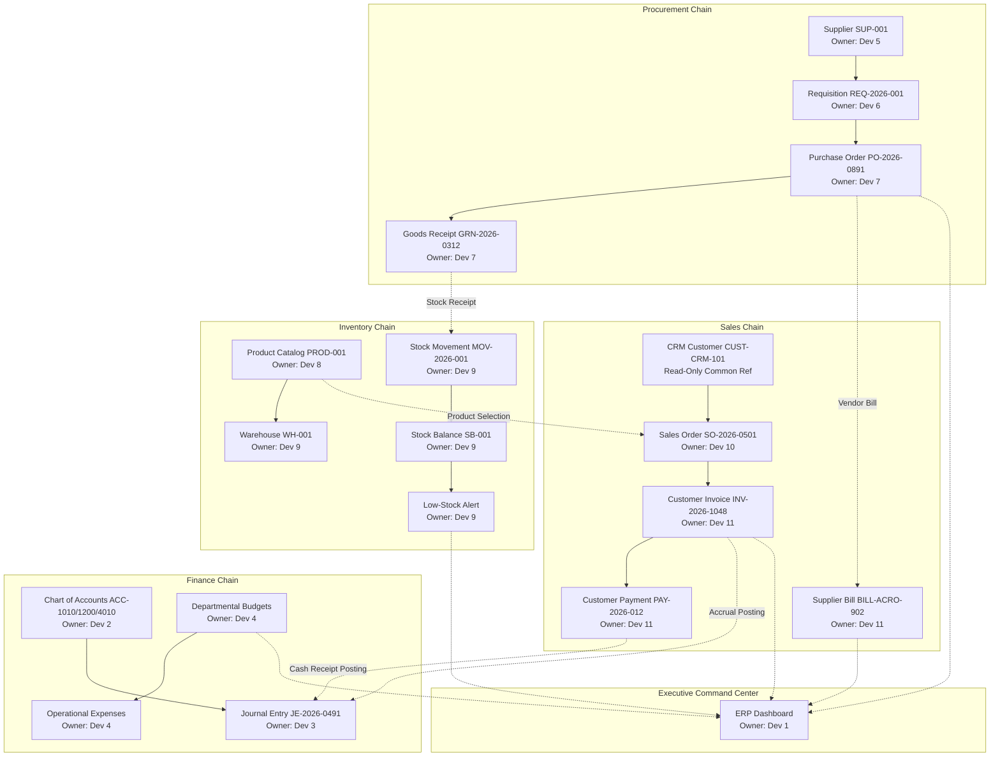

# OneCloud Enterprise ERP — 12-Developer Architecture, Specification & Implementation Guide

Welcome to the definitive **12-Developer Architecture & Implementation Guide** for the OneCloud Enterprise ERP module.

This document provides complete, actionable specifications for each of the 12 primary developer assignments, enforces the single-owner shared contract governance model, documents cross-domain dependencies, and outlines the parallel execution sequence.

---

## Part 1: Architecture, Governance & Boundary Rules

### 1.1 The Core Pattern: Page → Hook → Service → Mock
All ERP features strictly adhere to a four-tier unidirectional data flow:

```text
┌────────────────────────────────────────────────────────┐
│  1. Page / Screen Component                            │
│  - Presentation, layout, user interactions             │
│  - Strictly consumes domain TanStack Query hooks       │
│  - Direct axios/fetch calls are strictly prohibited    │
└───────────────────────────┬────────────────────────────┘
                            │ useQuery / useMutation
                            ▼
┌────────────────────────────────────────────────────────┐
│  2. React Query Hook Layer                             │
│  - Cache management, optimistic updates, invalidation  │
│  - Consumes type-safe keys from ERP_QUERY_KEYS         │
└───────────────────────────┬────────────────────────────┘
                            │ Async service calls
                            ▼
┌────────────────────────────────────────────────────────┐
│  3. Domain Service Layer                               │
│  - Business logic, validation rules, error handling    │
│  - Simulates 250ms–350ms network latency               │
│  - Operates on typed in-memory data store              │
└───────────────────────────┬────────────────────────────┘
                            │ Reads / Mutates in-memory records
                            ▼
┌────────────────────────────────────────────────────────┐
│  4. Authoritative Mock Datasets                        │
│  - Reconciled cross-module IDs & balanced calculations │
│  - Stable, predictable fixtures (no random data)       │
└────────────────────────────────────────────────────────┘
```

### 1.2 Module Boundaries & Prohibitions
1. **HRMS Boundary**: HRMS owns personnel, payroll, and recruitment. ERP consumes read-only employee projections via `HrmsEmployeeReference` (in `common.types.ts`) for requisition creation, approval attribution, and warehouse operations. **Do not modify files in `src/features/hrms/**`.**
2. **CRM Boundary**: CRM owns customer accounts, leads, and sales pipelines. ERP consumes read-only customer projections via `CrmCustomerReference` (in `common.types.ts`) for sales order fulfillment and customer invoicing. **Do not modify files in `src/features/crm/**`.**
3. **Application Shell Boundary**: Navigation links and application shells are registered in `src/app/layouts/AppLayout.tsx` and `src/app/config/navigation.config.ts`. **Do not modify shared app or layout files.**
4. **Global Design System**: All UI screens must use `@/shared/components/ui/` (`PageShell`, `PageContainer`, `Button`, `Input`, `Label`, `DropdownMenu`, `Tooltip`, `Avatar`, `ToastProvider`) and Tailwind CSS classes. Do not create new global styles.
5. **No Package Additions**: Do not install or add npm dependencies to `package.json`.

---

## Part 2: Single-Owner Shared Contracts Registry & Change Protocol

### 2.1 Authoritative Contract Ownership Matrix

Every shared interface has exactly **one canonical owner**. Other developers consume that contract as a read-only import.

| Domain Contract | Canonical Owner | Canonical File Location | Consuming Developer Roles | Status in Foundation |
| :--- | :--- | :--- | :--- | :--- |
| **Foundational & Shared IDs** | **Developer 12** | `src/features/erp/types/common.types.ts` | All Developers (1–12) | **Existing & Verified** |
| `Money`, `CurrencyCode`, `AuditMetadata` | **Developer 12** | `src/features/erp/types/common.types.ts` | All Developers (1–12) | **Existing & Verified** |
| `HrmsEmployeeReference` (Read-Only) | **Developer 12** | `src/features/erp/types/common.types.ts` | Dev 1, 4, 6, 7, 9 | **Existing & Verified** |
| `CrmCustomerReference` (Read-Only) | **Developer 12** | `src/features/erp/types/common.types.ts` | Dev 1, 10, 11 | **Existing & Verified** |
| **Chart of Accounts (`Account`)** | **Developer 2** | `src/features/erp/types/finance.types.ts` | Dev 1, 3, 4, 11 | **Existing & Verified** |
| **General Ledger (`JournalEntry`)** | **Developer 3** | `src/features/erp/types/finance.types.ts` | Dev 1, 2, 11 | **Existing & Verified** |
| **Budgets & Expenses (`Budget`, `Expense`)**| **Developer 4** | `src/features/erp/types/finance.types.ts` | Dev 1, 2 | **Existing & Verified** |
| **Suppliers & Vendors (`Supplier`)** | **Developer 5** | `src/features/erp/types/procurement.types.ts`| Dev 1, 6, 7, 11 | **Existing & Verified** |
| **Requisitions (`PurchaseRequisition`)** | **Developer 6** | `src/features/erp/types/procurement.types.ts`| Dev 1, 7 | **Existing & Verified** |
| **Orders & GRN (`PurchaseOrder`, `GRN`)**| **Developer 7** | `src/features/erp/types/procurement.types.ts`| Dev 1, 5, 6, 9, 11 | **Existing & Verified** |
| **Product Catalog (`Product`)** | **Developer 8** | `src/features/erp/types/inventory.types.ts` | Dev 1, 6, 7, 9, 10 | **Existing & Verified** |
| **Warehouses & Stock (`StockBalance`)** | **Developer 9** | `src/features/erp/types/inventory.types.ts` | Dev 1, 7, 8, 10 | **Existing & Verified** |
| **Sales Orders (`SalesOrder`)** | **Developer 10** | `src/features/erp/types/sales.types.ts` | Dev 1, 9, 11 | **Existing & Verified** |
| **Invoices & Payments (`Invoice`, `Payment`)**| **Developer 11** | `src/features/erp/types/sales.types.ts` | Dev 1, 3, 7, 10 | **Existing & Verified** |
| **Dashboard Metrics (`ErpDashboardData`)**| **Developer 1** | `src/features/erp/types/dashboard.types.ts` | Dev 12 | **Existing & Verified** |

### 2.2 Shared Contract Change Protocol
To prevent merge conflicts and inconsistent type assertions when multiple developers work in parallel:
1. **Identification**: A consumer identifies a missing field or incompatible type in a shared contract.
2. **Documentation**: The consumer documents the requirement in an issue or PR comment addressed to the canonical contract owner.
3. **Review**: The canonical owner reviews the proposed change to ensure it satisfies domain rules.
4. **Update**: The canonical owner updates the canonical type file on their feature branch or coordinated PR.
5. **Consumption**: Consumers update their code to match the newly approved contract.
6. **Verification**: Developer 12 runs `npm run typecheck` and the ERP test suite to confirm zero regressions.
*Rule: Never edit another developer's contract file directly.*

---

## Part 3: Cross-Domain Dependencies & Implementation Sequence

### 3.1 Cross-Domain Workflow Architecture
The ERP system models four interconnected business chains:



### 3.2 10-Step Parallel Implementation Sequence
Because all foundational contracts, mock datasets, and services are already established, developers can work concurrently without blocking each other:

1. **Step 1 (Branching)**: Each developer branches from `dev`: `feature/erp-dev<#>-<feature-name>` (e.g. `feature/erp-dev02-accounts`).
2. **Step 2 (Contract Audit)**: Review the assigned section in this guide and the existing types in `src/features/erp/types/`.
3. **Step 3 (Service & Mock Verification)**: Check existing service methods in `src/features/erp/services/`. Implement any assigned *proposed* service methods.
4. **Step 4 (Hook Layer)**: Implement feature-specific TanStack Query hooks using `ERP_QUERY_KEYS`.
5. **Step 5 (Component Assembly)**: Build domain-specific UI components using `@/shared/components/ui/` and Tailwind CSS.
6. **Step 6 (Page Assembly)**: Replace placeholder route files (or build new sub-pages) with production-grade screens implementing Loading, Error, Empty, and Success states.
7. **Step 7 (Form Validation)**: Use `react-hook-form` + `zod` for all transactional forms (schemas in a dedicated `schemas/` folder).
8. **Step 8 (Cross-Feature Linking)**: Connect action buttons to deep links (e.g., Low Stock banner links to "Create Requisition").
9. **Step 9 (Quality Gate)**: Run `npm run typecheck` and the ERP test suite locally before opening PRs.
10. **Step 10 (Review & Merge)**: Developer 12 conducts cross-module PR review and coordinates merge into `dev`.

---

## Part 4: UI Consistency & Design System Standards

All ERP screens must look visually cohesive and follow the established OneCloud design system:

### 4.1 Page Layout & Spacing
- Use `PageShell` from `@/shared/components/ui/PageShell` as the root wrapper:
  ```tsx
  <PageShell
    domain="ERP"
    title="Feature Title"
    description="Clear description of the business workflow."
  >
    <div className="space-y-6">
      {/* Content */}
    </div>
  </PageShell>
  ```
- Grid Spacing: `gap-4 sm:gap-6`. Padding: `p-4 sm:p-6 lg:p-8`.
- Card Containers: `rounded-xl border border-slate-200 bg-white p-5 shadow-xs hover:border-slate-300 transition-all`.

### 4.2 Typography & Semantic Color Tokens
- Font: Inter / Outfit system font stack.
- Text Hierarchy: Headers `text-lg font-bold text-slate-900`, Subtitles `text-xs text-slate-500`, Labels `text-xs font-medium text-slate-700`.
- Semantic Status Colors:
  - **Success / Active / Paid**: `bg-emerald-50 text-emerald-700 border-emerald-200`
  - **Warning / Pending / Partial**: `bg-amber-50 text-amber-700 border-amber-200`
  - **Critical / Overdue / Imbalanced**: `bg-rose-50 text-rose-700 border-rose-200`
  - **Informational / Issued**: `bg-blue-50 text-blue-700 border-blue-200`
  - **Procurement / Suppliers**: `bg-purple-50 text-purple-700 border-purple-200`

### 4.3 Mandatory UI States for Every Screen
Every screen must handle all four states gracefully:
1. **Loading**: Use pulsing skeleton blocks (`animate-pulse bg-slate-100 rounded-lg`). Do not display blank pages.
2. **Error**: Display inline error banner (`bg-rose-50 border border-rose-200 text-rose-800 p-4 rounded-xl`) with a "Retry Connection" button.
3. **Empty**: Show a centered empty-state illustration or icon (`lucide-react`), explanatory text, and a primary CTA (e.g. "Create New Supplier").
4. **Success / Data**: Render clean, responsive tables or grids with pagination and search/filtering controls.

---

## Part 5: Detailed 12-Developer Task Specifications

---

### Developer 1 — ERP Dashboard and Business Overview

#### A. Task Identity
- **Developer Number**: Developer 1
- **Task Title**: Enterprise ERP Executive Dashboard & Command Center
- **Business Purpose**: Provides executive leadership and operations directors with an immediate overview of cross-module procurement spend, inventory stock risks, accounts receivable, open sales orders, and operational alerts.
- **Expected Deliverables**: Connected executive dashboard screen (`/erp/dashboard`), KPI metrics grid, operational alerts drawer with deep links, recent enterprise transactions stream, and manual data refresh sync.
- **Definition of Done**: `/erp/dashboard` renders all 6 live enterprise KPIs, 4 operational alerts, and 5 recent transactions with responsive layouts (375px to 1920px), verified against `erpDashboardService`.

#### B. File Ownership
- **Feature Directory**: `src/features/erp/dashboard/`
- **Existing Files to Edit**:
  - `src/features/erp/dashboard/DashboardPage.tsx`
  - `src/features/erp/components/ErpKpiCard.tsx`
  - `src/features/erp/components/ErpAlertList.tsx`
  - `src/features/erp/components/ErpTransactionsTable.tsx`
  - `src/features/erp/components/ErpStatusBadge.tsx`
- **New Files to Create (Proposed)**:
  - `src/features/erp/dashboard/components/QuickActionsBar.tsx (Proposed)`
  - `src/features/erp/dashboard/components/ModuleHealthStatus.tsx (Proposed)`
- **Files Owned by Other Developers**: Do not edit domain pages (`finance/*`, `procurement/*`, `inventory/*`, `sales/*`).
- **Files Explicitly Out of Permitted Scope**: `AppLayout.tsx`, `navigation.config.ts`, CRM/HRMS modules.

#### C. Existing Functionality to Reuse
- **Types**: `ErpKpiCardData`, `ErpDashboardMetrics`, `ErpTransaction`, `ErpOperationalAlert`, `ErpDashboardData` in `dashboard.types.ts` [EXISTING].
- **Mock Datasets**: `mockErpKpis`, `mockRecentTransactions`, `mockOperationalAlerts`, `mockDashboardData` in `dashboard.mock.ts` [EXISTING].
- **Service Functions**:
  - `erpDashboardService.getDashboardData(): Promise<ErpDashboardData>` [EXISTING - Dynamically aggregates live metrics]
  - `erpDashboardService.getKpis(): Promise<ErpKpiCardData[]>` [EXISTING]
  - `erpDashboardService.getRecentTransactions(): Promise<ErpTransaction[]>` [EXISTING]
  - `erpDashboardService.getOperationalAlerts(): Promise<ErpOperationalAlert[]>` [EXISTING]
- **Query Hooks**: `useErpDashboard()`, `useErpKpis()`, `useErpTransactions()`, `useErpAlerts()` in `useErpDashboard.ts` [EXISTING].
- **Query Keys**: `ERP_QUERY_KEYS.dashboard.*` in `erpQueryKeys.ts` [EXISTING].
- **Shared Components**: `PageShell`, `Button`, `DropdownMenu`, Lucide icons.

#### D. Types and Contracts
- **Import**: `Money`, `CurrencyCode` from `common.types.ts`.
- **Owns**: `dashboard.types.ts`.
- **Read-Only Contracts**: All domain contracts from Developers 2–11.
- **Public Exports**: `ErpDashboardPage` in `src/features/erp/index.ts`.

#### E. Service and Mock Implementation
- `getDashboardData()`: Aggregates pending POs, low-stock count, receivables, payables, open sales orders, and budget utilization. Already dynamically derives values from domain mock stores.
- `refetch()`: Triggers cache invalidation across `ERP_QUERY_KEYS.dashboard.all`.

#### F. UI Requirements
- 6-card KPI summary grid displaying title, value, change indicator, and category tag.
- Operational alerts section color-coded by severity (`critical` rose, `high` amber, `info` blue).
- Recent transactions table displaying Transaction #, Type, Entity, Date, Amount, and Semantic Status Badge.
- Responsive grid: 1 col on mobile, 2 col on tablet, 3-4 col on desktop.

#### G. Business Rules
- KPIs must strictly compute from underlying domain datasets (zero fabricated numbers).
- Low stock count must match live items where `isLowStock === true` (currently 3 items).
- Accounts receivable must equal outstanding balance across customer invoices ($20,611).

#### H. Dependencies
- Consumes domain services from Dev 5, 7, 8, 9, 10, 11 via `erpDashboardService`. Can proceed immediately in parallel.

#### I. Acceptance Criteria
- [ ] `/erp/dashboard` loads without React runtime exceptions.
- [ ] KPI cards render $19,845 pending POs, 3 low stock alerts, $20,611 receivables, and 77.1% budget utilization.
- [ ] "Refresh" button triggers cache refetch with spinning indicator.
- [ ] Passes `npm run typecheck` with 0 errors.

#### J. Developer Completion Report
Must document: Files modified, KPIs verified, cache invalidation tested, confirmation that no files outside `dashboard/` and `components/` were touched.

---

### Developer 2 — Finance and Chart of Accounts

#### A. Task Identity
- **Developer Number**: Developer 2
- **Task Title**: Chart of Accounts & Financial Account Hierarchy
- **Business Purpose**: Enables financial controllers to configure and manage the enterprise general ledger account hierarchy, assign account categories, and inspect live account balances.
- **Expected Deliverables**: Chart of Accounts management screen (`/erp/finance/accounts`), account details drawer, category filter, and account creation modal with validation.
- **Definition of Done**: User can browse all 9 foundation accounts, search by code/name, filter by classification, view debit/credit normal balance rules, and simulate account creation.

#### B. File Ownership
- **Feature Directory**: `src/features/erp/finance/accounts/`
- **Existing Files to Edit**: None (New subdirectory to establish).
- **New Files to Create (Proposed)**:
  - `src/features/erp/finance/accounts/pages/AccountsPage.tsx (Proposed)`
  - `src/features/erp/finance/accounts/components/AccountDetailsModal.tsx (Proposed)`
  - `src/features/erp/finance/accounts/components/AccountFormModal.tsx (Proposed)`
  - `src/features/erp/finance/accounts/components/AccountCategoryBadge.tsx (Proposed)`
  - `src/features/erp/finance/accounts/schemas/accountSchema.ts (Proposed)`
- **Files Owned by Other Developers**: `finance/journals/**` (Dev 3), `finance/budgets/**` (Dev 4).
- **Files Explicitly Out of Permitted Scope**: All non-ERP paths.

#### C. Existing Functionality to Reuse
- **Types**: `Account`, `AccountType`, `AccountCategory`, `AccountStatus` in `finance.types.ts` [EXISTING].
- **Mock Datasets**: `mockAccounts` in `finance.mock.ts` [EXISTING].
- **Service Functions**:
  - `erpFinanceService.listAccounts(): Promise<Account[]>` [EXISTING]
  - `erpFinanceService.getAccountById(id: string): Promise<Account>` [EXISTING]
  - `erpFinanceService.createAccount(data): Promise<Account>` [PROPOSED - To be implemented by Dev 2]
- **Query Hooks**: `useAccounts()`, `useAccount(id)` in `useErpFinance.ts` [EXISTING].
- **Query Keys**: `ERP_QUERY_KEYS.finance.accounts` [EXISTING].

#### D. Types and Contracts
- **Owns**: `Account`, `AccountType`, `AccountCategory`, `AccountStatus` in `finance.types.ts`.
- **Read-Only**: `Money`, `CurrencyCode` from `common.types.ts`.
- **Cross-Domain**: Provides `Account` interface to Dev 3 (Journals) and Dev 11 (Invoices).

#### E. Service and Mock Implementation
- `listAccounts()`: Returns 9 accounts (`ACC-1010` to `ACC-5010`).
- `createAccount(data)` [PROPOSED]: Validates 4-digit numeric code uniqueness, appends to `mockAccounts`, and returns created account.

#### F. UI Requirements
- Category filter pills: All, Assets, Liabilities, Equity, Revenue, Expenses.
- Data table: Account Code, Account Name, Category, Normal Balance (Debit/Credit), Current Balance, Status.
- Account Form Modal: Code (4 digits), Name, Category dropdown, Currency selector (`USD`, `EUR`, `GBP`).

#### G. Business Rules
- Account codes must be 4 numeric digits: `1xxx` Assets, `2xxx` Liabilities, `3xxx` Equity, `4xxx` Revenue, `5xxx` Expenses.
- Normal balances: Assets & Expenses = Debit; Liabilities, Equity, Revenue = Credit.

#### H. Dependencies
- Independent foundation role; can begin immediately. Hands off `Account` definitions to Dev 3.

#### I. Acceptance Criteria
- [ ] Displays all 9 foundation accounts with correct debit/credit balances.
- [ ] Category filtering correctly isolates Assets, Liabilities, and Expenses.
- [ ] Account creation form validates 4-digit code using Zod schema.
- [ ] `npm run typecheck` passes with 0 errors.

#### J. Developer Completion Report
Must document: Files created, services added, validation schema details, zero out-of-scope modifications.

---

### Developer 3 — General Ledger and Journal Entries

#### A. Task Identity
- **Developer Number**: Developer 3
- **Task Title**: Double-Entry General Ledger & Journal Entry Management
- **Business Purpose**: Enforces GAAP/IFRS double-entry bookkeeping by recording journal vouchers with balanced debit and credit allocations.
- **Expected Deliverables**: Chronological journal entry log (`/erp/finance/journals`), line item expansion drawer, and balanced voucher creation form with dynamic debit/credit indicator.
- **Definition of Done**: User can view existing posted journal entries, expand debit/credit lines, and submit new vouchers with strict validation blocking unbalanced entries.

#### B. File Ownership
- **Feature Directory**: `src/features/erp/finance/journals/`
- **Existing Files to Edit**: None.
- **New Files to Create (Proposed)**:
  - `src/features/erp/finance/journals/pages/JournalEntriesPage.tsx (Proposed)`
  - `src/features/erp/finance/journals/components/JournalEntryDetailsModal.tsx (Proposed)`
  - `src/features/erp/finance/journals/components/JournalEntryForm.tsx (Proposed)`
  - `src/features/erp/finance/journals/components/DebitCreditIndicator.tsx (Proposed)`
  - `src/features/erp/finance/journals/schemas/journalEntrySchema.ts (Proposed)`
- **Files Owned by Other Developers**: `finance/accounts/**` (Dev 2), `finance/budgets/**` (Dev 4).

#### C. Existing Functionality to Reuse
- **Types**: `JournalEntry`, `JournalLine`, `JournalEntryStatus`, `JournalLineType` in `finance.types.ts` [EXISTING].
- **Mock Datasets**: `mockJournalEntries` in `finance.mock.ts` [EXISTING].
- **Service Functions**:
  - `erpFinanceService.listJournalEntries(): Promise<JournalEntry[]>` [EXISTING]
  - `erpFinanceService.createJournalEntry(entry): Promise<JournalEntry>` [EXISTING - Enforces double-entry balance check]
- **Query Hooks**: `useJournalEntries()`, `useCreateJournalEntry()` in `useErpFinance.ts` [EXISTING].
- **Query Keys**: `ERP_QUERY_KEYS.finance.journalEntries` [EXISTING].

#### D. Types and Contracts
- **Owns**: `JournalEntry`, `JournalLine`, `JournalEntryStatus`, `JournalLineType`.
- **Consumes**: `Account` from Dev 2.

#### E. Service and Mock Implementation
- `createJournalEntry()`: Validates that $\sum \text{Debit} === \sum \text{Credit}$. Throws error if unbalanced. Appends entry to `mockJournalEntries` with status `Posted`.

#### F. UI Requirements
- Voucher list table: Journal #, Date, Description, Reference, Total Debit, Total Credit, Status pill (`Posted` in emerald).
- Line item editor: Add row button, Account selector dropdown, Description input, Debit input, Credit input, Row delete.
- Running balance footer: Displays Total Debit, Total Credit, Difference, and Imbalance Warning badge.

#### G. Business Rules
- $\sum \text{Debit} === \sum \text{Credit}$ (tolerance $< 0.001$).
- Minimum of 2 lines per journal entry.
- Negative debit/credit amounts are strictly forbidden.

#### H. Dependencies
- Consumes account IDs from Developer 2 (`mockAccounts`).

#### I. Acceptance Criteria
- [ ] Journal vouchers `JE-2026-0491` and `JE-2026-0492` render with matching debits and credits.
- [ ] Form blocks submission and displays error when debits and credits do not balance.
- [ ] Valid submission creates voucher and invalidates `journalEntries` query key.
- [ ] `npm run typecheck` passes with 0 errors.

#### J. Developer Completion Report
Must document: Validation logic, test cases executed (balanced vs unbalanced), confirmation that `AppLayout` and non-ERP files were untouched.

---

### Developer 4 — Budgeting and Expense Management

#### A. Task Identity
- **Developer Number**: Developer 4
- **Task Title**: Departmental Budgeting & Operational Expense Tracking
- **Business Purpose**: Tracks organizational spending against approved departmental budget pools, calculating live utilization percentages and managing employee expense claims.
- **Expected Deliverables**: Budget overview screen (`/erp/finance/budgets`), utilization progress bars, expense claims table (`/erp/finance/expenses`), and claim submission modal.
- **Definition of Done**: Displays fiscal year budget pools with color-coded utilization rates, lists expense claims, and supports new claim submission.

#### B. File Ownership
- **Feature Directory**: `src/features/erp/finance/budgets/` & `src/features/erp/finance/expenses/`
- **Existing Files to Edit**: None.
- **New Files to Create (Proposed)**:
  - `src/features/erp/finance/budgets/pages/BudgetsPage.tsx (Proposed)`
  - `src/features/erp/finance/expenses/pages/ExpensesPage.tsx (Proposed)`
  - `src/features/erp/finance/budgets/components/BudgetProgressBar.tsx (Proposed)`
  - `src/features/erp/finance/expenses/components/ExpenseClaimFormModal.tsx (Proposed)`
  - `src/features/erp/finance/expenses/schemas/expenseSchema.ts (Proposed)`
- **Files Owned by Other Developers**: `finance/accounts/**` (Dev 2), `finance/journals/**` (Dev 3).

#### C. Existing Functionality to Reuse
- **Types**: `Budget`, `BudgetLine`, `Expense`, `ExpenseCategory`, `ExpenseStatus`, `FinancialSummary` in `finance.types.ts` [EXISTING].
- **Mock Datasets**: `mockBudgets`, `mockExpenses`, `mockFinancialSummary` in `finance.mock.ts` [EXISTING].
- **Service Functions**:
  - `erpFinanceService.listBudgets(): Promise<Budget[]>` [EXISTING]
  - `erpFinanceService.listExpenses(): Promise<Expense[]>` [EXISTING]
  - `erpFinanceService.getFinancialSummary(): Promise<FinancialSummary>` [EXISTING]
  - `erpFinanceService.createExpense(data): Promise<Expense>` [PROPOSED - To be implemented by Dev 4]
- **Query Hooks**: `useBudgets()`, `useExpenses()`, `useFinancialSummary()` in `useErpFinance.ts` [EXISTING].

#### D. Types and Contracts
- **Owns**: `Budget`, `BudgetLine`, `Expense`, `ExpenseCategory`, `ExpenseStatus`.
- **Consumes**: `HrmsEmployeeReference` from `common.types.ts`.

#### E. Service and Mock Implementation
- `listBudgets()`: Returns departmental budget pools ($620,000 total allocated, $478,000 spent).
- `createExpense(data)` [PROPOSED]: Validates positive amount, sets status `Submitted`, and appends to `mockExpenses`.

#### F. UI Requirements
- Budget cards: Department name, allocated amount, spent amount, remaining amount, and visual progress bar.
- Utilization bar coloring: Emerald for $<80\%$, Amber for $80\%–99\%$, Rose for $\ge 100\%$.
- Expense claims table: Claim ID, Employee Name, Category, Date, Amount, Status badge (`Approved`, `Submitted`).

#### G. Business Rules
- $\text{Utilization \%} = (\text{Spent} / \text{Allocated}) \times 100$.
- Expense amounts must be positive numbers.
- Claims exceeding $5,000 require executive approval flag.

#### H. Dependencies
- Consumes `HrmsEmployeeReference` for employee attribution.

#### I. Acceptance Criteria
- [ ] Displays Engineering Q4 budget ($250,000 allocated, $182,400 spent = 72.96% utilization).
- [ ] Progress bars reflect correct color thresholds.
- [ ] Expense claim submission updates local query cache.
- [ ] `npm run typecheck` passes with 0 errors.

#### J. Developer Completion Report
Must document: Files created, progress bar component implementation, budget math verification, confirmation of boundary compliance.

---

### Developer 5 — Supplier and Vendor Management

#### A. Task Identity
- **Developer Number**: Developer 5
- **Task Title**: Enterprise Supplier Master & Vendor Management
- **Business Purpose**: Manages the vendor database, compliance details, contact records, payment terms, and performance ratings.
- **Expected Deliverables**: Vendor directory screen (`/erp/vendors`), supplier profile drawer, vendor rating component, and supplier creation modal.
- **Definition of Done**: `/erp/vendors` allows searching and filtering all 5 mock suppliers, viewing contact and payment terms details, and simulating supplier onboarding.

#### B. File Ownership
- **Feature Directory**: `src/features/erp/vendors/` & `src/features/erp/procurement/suppliers/`
- **Existing Files to Edit**:
  - `src/features/erp/vendors/VendorsPage.tsx` [EXISTING placeholder to be developed into full screen].
- **New Files to Create (Proposed)**:
  - `src/features/erp/procurement/suppliers/components/SupplierCard.tsx (Proposed)`
  - `src/features/erp/procurement/suppliers/components/SupplierDetailsModal.tsx (Proposed)`
  - `src/features/erp/procurement/suppliers/components/SupplierFormModal.tsx (Proposed)`
  - `src/features/erp/procurement/suppliers/components/RatingStars.tsx (Proposed)`
  - `src/features/erp/procurement/suppliers/schemas/supplierSchema.ts (Proposed)`
- **Files Owned by Other Developers**: `procurement/requisitions/**` (Dev 6), `procurement/orders/**` (Dev 7).

#### C. Existing Functionality to Reuse
- **Types**: `Supplier`, `SupplierContact`, `SupplierStatus`, `PaymentTerms` in `procurement.types.ts` [EXISTING].
- **Mock Datasets**: `mockSuppliers` in `suppliers.mock.ts` [EXISTING].
- **Service Functions**:
  - `erpProcurementService.listSuppliers(): Promise<Supplier[]>` [EXISTING]
  - `erpProcurementService.getSupplierById(id: string): Promise<Supplier>` [EXISTING]
  - `erpProcurementService.createSupplier(data): Promise<Supplier>` [PROPOSED - To be implemented by Dev 5]
- **Query Hooks**: `useSuppliers()`, `useSupplier(id)` in `useErpProcurement.ts` [EXISTING].
- **Query Keys**: `ERP_QUERY_KEYS.procurement.suppliers` [EXISTING].

#### D. Types and Contracts
- **Owns**: `Supplier`, `SupplierContact`, `SupplierStatus`, `PaymentTerms` in `procurement.types.ts`.
- **Supplies**: Provides `Supplier` contract to Dev 6 (Requisitions), Dev 7 (POs), and Dev 11 (Bills).

#### E. Service and Mock Implementation
- `listSuppliers()`: Returns 5 enterprise vendors (AcroTech, Nippon Precision, Titan Hydraulics, etc.).
- `createSupplier(data)` [PROPOSED]: Validates tax ID and email format, sets default rating, appends to `mockSuppliers`.

#### F. UI Requirements
- Vendor table/grid with search input, category filter (Robotics, Electronics, Hydraulics, Fasteners, Consumables).
- Rating stars display (1.0 to 5.0).
- Payment terms badges: `Net 15`, `Net 30`, `Net 45`, `Net 60`.
- Supplier detail view showing primary contact, email, phone, address, and active PO count.

#### G. Business Rules
- Vendor tax ID is required and must follow standard format.
- Vendor rating bounded between 1.0 and 5.0.

#### H. Dependencies
- Foundation role; supplies supplier data to Dev 6 and Dev 7. Can proceed immediately.

#### I. Acceptance Criteria
- [ ] `/erp/vendors` renders 5 mock suppliers with categories and ratings.
- [ ] Search filter works by supplier name and category.
- [ ] Clicking a supplier opens details modal with complete contact info.
- [ ] `npm run typecheck` passes with 0 errors.

#### J. Developer Completion Report
Must document: Changes to `VendorsPage.tsx`, new components created, supplier schema validation, zero out-of-scope edits.

---

### Developer 6 — Purchase Requisitions and Approvals

#### A. Task Identity
- **Developer Number**: Developer 6
- **Task Title**: Purchase Requisition Workflows & Approval Authorization
- **Business Purpose**: Enables departmental employees to submit procurement requests and routes them through approval authorization before PO conversion.
- **Expected Deliverables**: Requisition list screen (`/erp/procurement/requisitions`), requisition line item editor, priority tags, and manager approval/rejection actions.
- **Definition of Done**: User can view submitted requisitions, submit a new multi-item requisition, and execute simulated approval transitioning status to `Approved`.

#### B. File Ownership
- **Feature Directory**: `src/features/erp/procurement/requisitions/`
- **Existing Files to Edit**: None.
- **New Files to Create (Proposed)**:
  - `src/features/erp/procurement/requisitions/pages/RequisitionsPage.tsx (Proposed)`
  - `src/features/erp/procurement/requisitions/components/RequisitionFormModal.tsx (Proposed)`
  - `src/features/erp/procurement/requisitions/components/RequisitionLinesTable.tsx (Proposed)`
  - `src/features/erp/procurement/requisitions/components/ApprovalActionDialog.tsx (Proposed)`
  - `src/features/erp/procurement/requisitions/schemas/requisitionSchema.ts (Proposed)`
- **Files Owned by Other Developers**: `procurement/suppliers/**` (Dev 5), `procurement/orders/**` (Dev 7).

#### C. Existing Functionality to Reuse
- **Types**: `PurchaseRequisition`, `RequisitionLineItem`, `RequisitionStatus`, `RequisitionPriority` in `procurement.types.ts` [EXISTING].
- **Mock Datasets**: `mockRequisitions` in `procurement.mock.ts` [EXISTING].
- **Service Functions**:
  - `erpProcurementService.listRequisitions(): Promise<PurchaseRequisition[]>` [EXISTING]
  - `erpProcurementService.getRequisitionById(id: string): Promise<PurchaseRequisition>` [EXISTING]
  - `erpProcurementService.createRequisition(data, employee): Promise<PurchaseRequisition>` [EXISTING]
  - `erpProcurementService.approveRequisition(id: string, approver: HrmsEmployeeReference): Promise<PurchaseRequisition>` [PROPOSED - To be implemented by Dev 6]
- **Query Hooks**: `useRequisitions()`, `useRequisition(id)`, `useCreateRequisition()` in `useErpProcurement.ts` [EXISTING].
- **Query Keys**: `ERP_QUERY_KEYS.procurement.requisitions` [EXISTING].

#### D. Types and Contracts
- **Owns**: `PurchaseRequisition`, `RequisitionLineItem`, `RequisitionStatus`, `RequisitionPriority`.
- **Consumes**: `Product` from Dev 8, `HrmsEmployeeReference` from `common.types.ts`.

#### E. Service and Mock Implementation
- `createRequisition()`: Generates `REQ-` ID, computes estimated totals, sets status `Submitted`.
- `approveRequisition()` [PROPOSED]: Transitions status to `Approved`, records `approvedBy` and `approvedAt`.

#### F. UI Requirements
- Tabs: All, Submitted (Pending Approval), Approved, Rejected.
- Priority pills: `Urgent` (rose), `High` (amber), `Medium` (blue), `Low` (slate).
- Line item form: Product selector, quantity input, estimated unit cost, auto-calculated line total.

#### G. Business Rules
- At least 1 item with quantity $\ge 1$ required.
- Approval requires manager signature timestamp.

#### H. Dependencies
- Consumes `Product` catalog from Dev 8 and hands off approved requisitions to Dev 7 for PO issuance.

#### I. Acceptance Criteria
- [ ] Lists existing requisitions (e.g. `REQ-2026-001` for $18,375).
- [ ] Submission of new requisition adds record and invalidates cache.
- [ ] Approval action changes status to `Approved`.
- [ ] `npm run typecheck` passes with 0 errors.

#### J. Developer Completion Report
Must document: Files created, service methods added, approval workflow behavior, zero out-of-scope edits.

---

### Developer 7 — Purchase Orders and Goods Receiving

#### A. Task Identity
- **Developer Number**: Developer 7
- **Task Title**: Purchase Orders Lifecycle & Goods Received Notes (GRN)
- **Business Purpose**: Manages official vendor purchase orders, tracks receipt progress against dock deliveries, and records Goods Received Notes (GRN).
- **Expected Deliverables**: Purchase orders page (`/erp/procurement`), PO detail view with fulfillment progress bars, and Goods Received Note (GRN) inspection modal.
- **Definition of Done**: `/erp/procurement` displays active purchase orders, shows ordered vs received quantities, and allows recording a GRN dock delivery.

#### B. File Ownership
- **Feature Directory**: `src/features/erp/procurement/` & `src/features/erp/procurement/orders/` & `src/features/erp/procurement/grn/`
- **Existing Files to Edit**:
  - `src/features/erp/procurement/ProcurementPage.tsx` [EXISTING placeholder to be developed].
- **New Files to Create (Proposed)**:
  - `src/features/erp/procurement/orders/components/PoLineReceivingTable.tsx (Proposed)`
  - `src/features/erp/procurement/orders/components/PurchaseOrderDetailsModal.tsx (Proposed)`
  - `src/features/erp/procurement/grn/components/GoodsReceiptModal.tsx (Proposed)`
  - `src/features/erp/procurement/orders/schemas/purchaseOrderSchema.ts (Proposed)`
- **Files Owned by Other Developers**: `procurement/suppliers/**` (Dev 5), `procurement/requisitions/**` (Dev 6).

#### C. Existing Functionality to Reuse
- **Types**: `PurchaseOrder`, `PurchaseOrderLineItem`, `PurchaseOrderStatus`, `GoodsReceivedNote`, `GoodsReceivedLineItem`, `GrnStatus` in `procurement.types.ts` [EXISTING].
- **Mock Datasets**: `mockPurchaseOrders`, `mockGoodsReceipts` in `procurement.mock.ts` [EXISTING].
- **Service Functions**:
  - `erpProcurementService.listPurchaseOrders(): Promise<PurchaseOrder[]>` [EXISTING]
  - `erpProcurementService.getPurchaseOrderById(id: string): Promise<PurchaseOrder>` [EXISTING]
  - `erpProcurementService.listGoodsReceipts(): Promise<GoodsReceivedNote[]>` [EXISTING]
  - `erpProcurementService.createGoodsReceipt(data): Promise<GoodsReceivedNote>` [PROPOSED - To be implemented by Dev 7]
- **Query Hooks**: `usePurchaseOrders()`, `usePurchaseOrder(id)`, `useGoodsReceipts()` in `useErpProcurement.ts` [EXISTING].
- **Query Keys**: `ERP_QUERY_KEYS.procurement.purchaseOrders`, `goodsReceipts` [EXISTING].

#### D. Types and Contracts
- **Owns**: `PurchaseOrder`, `GoodsReceivedNote` contracts.
- **Consumes**: `Supplier` from Dev 5, `Product` from Dev 8.

#### E. Service and Mock Implementation
- `listPurchaseOrders()`: Returns 3 POs (`PO-2026-0891`, `0892`, `0893`).
- `createGoodsReceipt(data)` [PROPOSED]: Validates received quantity against remaining quantity, generates `GRN-` ID, updates PO status to `Partially Received` or `Received`.

#### F. UI Requirements
- PO table: PO #, Supplier Name, Issue Date, Expected Delivery, Total Amount, Status badge.
- Receiving Progress: Visual bar showing e.g. 10 of 15 items received ($66.7\%$).
- GRN Modal: Input received quantity and warehouse location (`WH-001`, `WH-002`).

#### G. Business Rules
- Line total = $\text{Quantity} \times \text{UnitPrice}$; $\text{TotalAmount} = \text{Subtotal} + \text{Tax}$.
- $\text{QuantityReceived} \le \text{QuantityOrdered}$.
- When all line items are fully received, PO status transitions to `Received`.

#### H. Dependencies
- Hand off GRN records to Developer 9 (Warehouse) to increment stock balances.

#### I. Acceptance Criteria
- [ ] `/erp/procurement` lists `PO-2026-0891` ($19,845 total, `Partially Received`).
- [ ] GRN creation modal properly validates quantities.
- [ ] `npm run typecheck` passes with 0 errors.

#### J. Developer Completion Report
Must document: Changes to `ProcurementPage.tsx`, GRN components created, math verification, zero boundary violations.

---

### Developer 8 — Products and Item Catalog

#### A. Task Identity
- **Developer Number**: Developer 8
- **Task Title**: Product Master Catalog & Unit of Measure Specifications
- **Business Purpose**: Centralizes product definitions, component parts, raw materials, units of measure, standard costs, and target sales prices.
- **Expected Deliverables**: Product catalog view (`/erp/inventory/products`), item card/table views, category taxonomy chips, and product creation modal.
- **Definition of Done**: Displays all 5 foundation products across Raw Materials, Components, and Finished Goods with correct margin calculations and reorder thresholds.

#### B. File Ownership
- **Feature Directory**: `src/features/erp/inventory/products/`
- **Existing Files to Edit**: None.
- **New Files to Create (Proposed)**:
  - `src/features/erp/inventory/products/pages/ProductCatalogPage.tsx (Proposed)`
  - `src/features/erp/inventory/products/components/ProductCard.tsx (Proposed)`
  - `src/features/erp/inventory/products/components/ProductFormModal.tsx (Proposed)`
  - `src/features/erp/inventory/products/components/UnitOfMeasureSelect.tsx (Proposed)`
  - `src/features/erp/inventory/products/schemas/productSchema.ts (Proposed)`
- **Files Owned by Other Developers**: `inventory/warehouse/**` (Dev 9).

#### C. Existing Functionality to Reuse
- **Types**: `Product`, `ProductCategory`, `UnitOfMeasure`, `ProductStatus` in `inventory.types.ts` [EXISTING].
- **Mock Datasets**: `mockProducts` in `inventory.mock.ts` [EXISTING].
- **Service Functions**:
  - `erpInventoryService.listProducts(): Promise<Product[]>` [EXISTING]
  - `erpInventoryService.getProductById(id: string): Promise<Product>` [EXISTING]
  - `erpInventoryService.createProduct(data): Promise<Product>` [PROPOSED - To be implemented by Dev 8]
- **Query Hooks**: `useProducts()`, `useProduct(id)` in `useErpInventory.ts` [EXISTING].
- **Query Keys**: `ERP_QUERY_KEYS.inventory.products` [EXISTING].

#### D. Types and Contracts
- **Owns**: `Product`, `ProductCategory`, `UnitOfMeasure`, `ProductStatus` in `inventory.types.ts`.
- **Supplies**: Product definitions to Dev 6 (Requisitions), Dev 7 (POs), Dev 9 (Stock), and Dev 10 (Sales).

#### E. Service and Mock Implementation
- `listProducts()`: Returns 5 items (`PROD-001` through `PROD-005`).
- `createProduct(data)` [PROPOSED]: Validates SKU format and unit price > unit cost, appends to `mockProducts`.

#### F. UI Requirements
- Category filter pills: All, Components, Raw Materials, Finished Goods.
- Grid vs Table view toggle.
- Price vs Cost badge with computed Gross Margin: $[(\text{Price} - \text{Cost}) / \text{Price}] \times 100$.

#### G. Business Rules
- SKU must be unique uppercase alphanumeric string (e.g. `SRV-48V-01`).
- Selling price must exceed standard unit cost.
- Reorder point must be a positive integer.

#### H. Dependencies
- Fundamental master data; supplies contracts to Dev 6, 7, 9, 10. Can proceed immediately.

#### I. Acceptance Criteria
- [ ] Displays all 5 products with images/icons and SKUs.
- [ ] Gross margin percentage correctly calculates.
- [ ] `npm run typecheck` passes with 0 errors.

#### J. Developer Completion Report
Must document: Files created, catalog layout features, validation logic, zero out-of-scope edits.

---

### Developer 9 — Inventory and Warehouse Management

#### A. Task Identity
- **Developer Number**: Developer 9
- **Task Title**: Warehouse Storage, Stock Balances & Movement Ledger
- **Business Purpose**: Tracks multi-facility warehouse storage capacities, real-time stock balances on hand, bin allocations, stock transfer movements, and automated low-stock warnings.
- **Expected Deliverables**: Inventory management screen (`/erp/inventory`), warehouse facility screen (`/erp/warehouse`), stock balance tables, low stock alerts panel, and stock transfer modal.
- **Definition of Done**: Renders real-time stock balances across Chicago, Fremont, and Rotterdam warehouses, displays 3 low stock alerts, and allows recording a simulated stock movement.

#### B. File Ownership
- **Feature Directory**: `src/features/erp/inventory/` & `src/features/erp/warehouse/`
- **Existing Files to Edit**:
  - `src/features/erp/inventory/InventoryPage.tsx` [EXISTING placeholder to be developed].
  - `src/features/erp/warehouse/WarehousePage.tsx` [EXISTING placeholder to be developed].
- **New Files to Create (Proposed)**:
  - `src/features/erp/warehouse/components/WarehouseCapacityBar.tsx (Proposed)`
  - `src/features/erp/warehouse/components/LowStockBanner.tsx (Proposed)`
  - `src/features/erp/warehouse/components/StockMovementsTable.tsx (Proposed)`
  - `src/features/erp/warehouse/components/StockAdjustmentModal.tsx (Proposed)`
  - `src/features/erp/warehouse/schemas/stockMovementSchema.ts (Proposed)`
- **Files Owned by Other Developers**: `inventory/products/**` (Dev 8).

#### C. Existing Functionality to Reuse
- **Types**: `Warehouse`, `StockBalance`, `StockMovement`, `StockMovementType`, `LowStockAlert` in `inventory.types.ts` [EXISTING].
- **Mock Datasets**: `mockWarehouses`, `mockStockBalances`, `mockStockMovements`, `mockLowStockAlerts` in `inventory.mock.ts` [EXISTING].
- **Service Functions**:
  - `erpInventoryService.listWarehouses(): Promise<Warehouse[]>` [EXISTING]
  - `erpInventoryService.listStockBalances(): Promise<StockBalance[]>` [EXISTING]
  - `erpInventoryService.listStockMovements(): Promise<StockMovement[]>` [EXISTING]
  - `erpInventoryService.listLowStockAlerts(): Promise<LowStockAlert[]>` [EXISTING]
  - `erpInventoryService.recordStockMovement(data): Promise<StockMovement>` [PROPOSED - To be implemented by Dev 9]
- **Query Hooks**: `useWarehouses()`, `useStockBalances()`, `useStockMovements()`, `useLowStockAlerts()` in `useErpInventory.ts` [EXISTING].
- **Query Keys**: `ERP_QUERY_KEYS.inventory.*` [EXISTING].

#### D. Types and Contracts
- **Owns**: `Warehouse`, `StockBalance`, `StockMovement`, `LowStockAlert` in `inventory.types.ts`.
- **Consumes**: `Product` from Dev 8.

#### E. Service and Mock Implementation
- `listStockBalances()`: Returns 5 balance records with reconciled quantities.
- `listLowStockAlerts()`: Returns 3 alerts (`SRV-48V-01`, `GRB-TI-03`, `SYS-ARM-6X`).
- `recordStockMovement()` [PROPOSED]: Creates movement record, updates `onHandQuantity` and `availableQuantity`.

#### F. UI Requirements
- Warehouse capacity cards (Chicago 85%, Fremont 64%, Rotterdam 42%) with progress bars.
- Stock balance table: Product Name, SKU, Warehouse, On Hand, Reserved, Available, Reorder Point, Status badge.
- Low-Stock banner at top of page with deep link: "Create Purchase Requisition".

#### G. Business Rules
- $\mathbf{Available = OnHand - Reserved}$.
- If $\text{OnHand} \le \text{ReorderPoint} \implies \text{isLowStock} = \text{true}$.
- Stock movement types: `Receipt`, `Shipment`, `Transfer`, `Adjustment`.

#### H. Dependencies
- Receives goods receipt updates from Dev 7 and fulfillment dispatch from Dev 10.

#### I. Acceptance Criteria
- [ ] `/erp/inventory` and `/erp/warehouse` render without errors.
- [ ] 3 low stock alerts clearly indicated with warning styling.
- [ ] Math holds: `availableQuantity === onHandQuantity - reservedQuantity`.
- [ ] `npm run typecheck` passes with 0 errors.

#### J. Developer Completion Report
Must document: Changes to `InventoryPage.tsx` and `WarehousePage.tsx`, components built, math verification, zero out-of-scope edits.

---

### Developer 10 — Sales Orders and Customer Billing

#### A. Task Identity
- **Developer Number**: Developer 10
- **Task Title**: Enterprise Sales Orders & Fulfillment Lifecycle
- **Business Purpose**: Captures customer sales orders, tracks product allocations, and manages fulfillment progress (`Unfulfilled` → `Partially Fulfilled` → `Fulfilled`).
- **Expected Deliverables**: Sales orders screen (`/erp/sales`), order creation modal, order detail view with line-item fulfillment tracking, and "Generate Invoice" trigger.
- **Definition of Done**: `/erp/sales` displays all 3 mock sales orders, shows fulfillment percentages, and supports simulated order creation.

#### B. File Ownership
- **Feature Directory**: `src/features/erp/sales/` & `src/features/erp/sales/orders/`
- **Existing Files to Edit**:
  - `src/features/erp/sales/SalesPage.tsx` [EXISTING placeholder to be developed].
- **New Files to Create (Proposed)**:
  - `src/features/erp/sales/orders/components/SalesOrderDetailsModal.tsx (Proposed)`
  - `src/features/erp/sales/orders/components/SalesOrderFormModal.tsx (Proposed)`
  - `src/features/erp/sales/orders/components/FulfillmentProgressBar.tsx (Proposed)`
  - `src/features/erp/sales/orders/schemas/salesOrderSchema.ts (Proposed)`
- **Files Owned by Other Developers**: `sales/invoices/**` (Dev 11).

#### C. Existing Functionality to Reuse
- **Types**: `SalesOrder`, `SalesOrderLineItem`, `SalesOrderStatus`, `FulfillmentStatus` in `sales.types.ts` [EXISTING].
- **Mock Datasets**: `mockSalesOrders`, `mockCrmCustomers` in `sales.mock.ts` [EXISTING].
- **Service Functions**:
  - `erpSalesService.listSalesOrders(): Promise<SalesOrder[]>` [EXISTING]
  - `erpSalesService.getSalesOrderById(id: string): Promise<SalesOrder>` [EXISTING]
  - `erpSalesService.createSalesOrder(data): Promise<SalesOrder>` [PROPOSED - To be implemented by Dev 10]
- **Query Hooks**: `useSalesOrders()`, `useSalesOrder(id)` in `useErpSales.ts` [EXISTING].
- **Query Keys**: `ERP_QUERY_KEYS.sales.orders` [EXISTING].

#### D. Types and Contracts
- **Owns**: `SalesOrder`, `SalesOrderLineItem`, `SalesOrderStatus`, `FulfillmentStatus` in `sales.types.ts`.
- **Consumes**: `CrmCustomerReference` from `common.types.ts`, `Product` from Dev 8.

#### E. Service and Mock Implementation
- `listSalesOrders()`: Returns 3 orders (`SO-2026-0501`, `0502`, `0503`).
- `createSalesOrder(data)` [PROPOSED]: Validates customer reference, calculates subtotal and tax, appends to `mockSalesOrders`.

#### F. UI Requirements
- Orders table: Order #, Customer Name, Order Date, Delivery Date, Total Value, Fulfillment Status pill.
- Fulfillment bar: Visual progress (e.g. 5 of 10 cobot arms fulfilled).
- Action dropdown: View Details, Generate Invoice (hands off to Dev 11).

#### G. Business Rules
- Customer data is strictly read-only reference from CRM (never mutate CRM tables).
- $\text{TotalAmount} = \text{Subtotal} + \text{Tax} - \text{Discount}$.
- Fulfilled quantity cannot exceed ordered quantity.

#### H. Dependencies
- Hands off confirmed sales order totals to Developer 11 for invoice generation.

#### I. Acceptance Criteria
- [ ] `/erp/sales` renders existing orders (e.g. `SO-2026-0501` for $13,176).
- [ ] Order detail view shows line items, customer name, and shipping address.
- [ ] `npm run typecheck` passes with 0 errors.

#### J. Developer Completion Report
Must document: Changes to `SalesPage.tsx`, components created, customer boundary respect, zero out-of-scope edits.

---

### Developer 11 — Invoices, Payments, and Financial Reporting

#### A. Task Identity
- **Developer Number**: Developer 11
- **Task Title**: Customer Invoicing, Vendor Bills & Payment Reconciliation
- **Business Purpose**: Generates customer invoices, records supplier vendor bills, tracks incoming customer payments, and monitors accounts receivable/payable aging.
- **Expected Deliverables**: Invoices management screen (`/erp/sales/invoices`), invoice details view, payment recording modal, and accounts receivable aging summary.
- **Definition of Done**: User can inspect customer invoices and vendor bills, record a customer payment reducing `amountDue`, and view receivables aging categories.

#### B. File Ownership
- **Feature Directory**: `src/features/erp/sales/invoices/` & `src/features/erp/sales/payments/`
- **Existing Files to Edit**: None.
- **New Files to Create (Proposed)**:
  - `src/features/erp/sales/invoices/pages/InvoicesPage.tsx (Proposed)`
  - `src/features/erp/sales/invoices/components/InvoiceDetailsModal.tsx (Proposed)`
  - `src/features/erp/sales/invoices/components/RecordPaymentModal.tsx (Proposed)`
  - `src/features/erp/sales/invoices/components/AgingSummaryCard.tsx (Proposed)`
  - `src/features/erp/sales/invoices/schemas/invoiceSchema.ts (Proposed)`
- **Files Owned by Other Developers**: `sales/orders/**` (Dev 10).

#### C. Existing Functionality to Reuse
- **Types**: `Invoice`, `InvoiceLineItem`, `InvoiceType`, `InvoiceStatus`, `Payment`, `PaymentMethod`, `PaymentStatus` in `sales.types.ts` [EXISTING].
- **Mock Datasets**: `mockInvoices`, `mockPayments` in `sales.mock.ts` [EXISTING].
- **Service Functions**:
  - `erpSalesService.listInvoices(): Promise<Invoice[]>` [EXISTING]
  - `erpSalesService.getInvoiceById(id: string): Promise<Invoice>` [EXISTING]
  - `erpSalesService.listPayments(): Promise<Payment[]>` [EXISTING]
  - `erpSalesService.recordPayment(data): Promise<Payment>` [PROPOSED - To be implemented by Dev 11]
- **Query Hooks**: `useInvoices()`, `useInvoice(id)`, `usePayments()` in `useErpSales.ts` [EXISTING].
- **Query Keys**: `ERP_QUERY_KEYS.sales.invoices`, `payments` [EXISTING].

#### D. Types and Contracts
- **Owns**: `Invoice`, `Payment` contracts in `sales.types.ts`.
- **Consumes**: `FinancialSummary` from `finance.types.ts`.

#### E. Service and Mock Implementation
- `listInvoices()`: Returns 2 customer invoices and 1 vendor bill ($14,661 from AcroTech).
- `recordPayment(data)` [PROPOSED]: Reduces invoice `amountDue`, increases `paidAmount`, transitions status to `Partially Paid` or `Paid`, and logs payment receipt.

#### F. UI Requirements
- Invoices table with filter: All, Customer Invoices, Vendor Bills, Overdue.
- Aging badges: `Current` (green), `30 Days` (amber), `60+ Days Overdue` (rose).
- Record Payment dialog with auto-calculated remaining balance.

#### G. Business Rules
- $\mathbf{AmountDue = TotalAmount - PaidAmount}$.
- If $\text{currentDate} > \text{dueDate} \land \text{amountDue} > 0 \implies \text{status} = \text{'Overdue'}$.
- Payment cannot exceed outstanding amount due.

#### H. Dependencies
- Receives sales order data from Dev 10 and vendor bills from Dev 7; feeds receivable totals to Dev 1.

#### I. Acceptance Criteria
- [ ] Displays $20,611 outstanding receivables (including $17,064 overdue invoice `INV-2026-1049`).
- [ ] Displays $14,661 vendor bill from AcroTech.
- [ ] Payment recording properly decrements `amountDue`.
- [ ] `npm run typecheck` passes with 0 errors.

#### J. Developer Completion Report
Must document: Files created, payment reconciliation verification, aging logic, zero out-of-scope edits.

---

### Developer 12 — ERP Integration, Configuration, and Quality Assurance

#### A. Task Identity
- **Developer Number**: Developer 12
- **Task Title**: Cross-Module ERP Integration, Routing & Quality Assurance
- **Business Purpose**: Protects architectural integrity across all 12 feature branches, validates cross-entity data consistency, maintains central export barrels, and runs automated regression tests.
- **Expected Deliverables**: Central ERP exports barrel (`src/features/erp/index.ts`), automated regression test suite (`src/features/erp/tests/erpVerification.test.ts`), and coordination of clean PR merges.
- **Definition of Done**: All 12 developer branches integrate cleanly without type conflicts, `npm run typecheck` passes with 0 errors, and all 55 ERP foundation tests pass.

#### B. File Ownership
- **Feature Directory**: `src/features/erp/` & `src/features/erp/docs/` & `src/features/erp/tests/`
- **Existing Files to Edit**:
  - `src/features/erp/index.ts`
  - `src/features/erp/constants/erpQueryKeys.ts`
  - `src/features/erp/types/common.types.ts`
  - `src/features/erp/tests/erpVerification.test.ts`
  - `src/features/erp/docs/ERP_12_DEVELOPER_GUIDE.md`
  - `ERP_DEVELOPER_GUIDE.md`
- **New Files to Create (Proposed)**:
  - `src/features/erp/tests/erpCrossModuleIntegration.test.ts (Proposed)`
- **Files Owned by Other Developers**: Must NOT author or rewrite domain feature pages of Developers 1–11.
- **Files Explicitly Out of Scope**: CRM, HRMS, and shared app configuration.

#### C. Existing Functionality to Reuse
- **Types**: Central barrel in `src/features/erp/types/index.ts` [EXISTING].
- **Mocks**: Central barrel in `src/features/erp/mocks/index.ts` [EXISTING].
- **Services**: Central barrel in `src/features/erp/services/index.ts` [EXISTING].
- **Hooks**: Central barrel in `src/features/erp/hooks/index.ts` [EXISTING].
- **Components**: Central barrel in `src/features/erp/components/index.ts` [EXISTING].
- **Verification Suite**: `src/features/erp/tests/erpVerification.test.ts` [EXISTING - 55 passing tests].

#### D. Types and Contracts
- **Owns**: `common.types.ts` and all barrel re-exports.
- **Enforces**: Zero `any` types, strict interface imports (`import type`), and single-owner protocol.

#### E. Service and Mock Implementation
- Audits all service exports to ensure consistent async signatures, delay simulations, and error propagation.

#### F. UI Requirements
- Verifies that all feature screens implement loading, error, empty, and success states before PR signoff.

#### G. Business Rules
- Zero typecheck errors allowed in any PR.
- All cross-module mock IDs must strictly align with the Authoritative Registry.

#### H. Dependencies
- Coordinates with Developers 1 through 11.

#### I. Acceptance Criteria
- [ ] `npm run typecheck` passes across the entire project with 0 errors.
- [ ] All 55 assertions in `erpVerification.test.ts` pass cleanly.
- [ ] Public exports in `src/features/erp/index.ts` are verified.

#### J. Developer Completion Report
Must document: Pull requests reviewed, test suite execution results, cross-module compatibility verification, zero repository mutations.

---

## Part 6: Collaboration Rules & Prohibitions for All 12 Developers

Every developer on the OneCloud ERP team must adhere strictly to these 10 collaboration rules:

1. **Strict Folder Boundaries**: Work exclusively within your assigned feature directory. Never edit files belonging to another developer's domain.
2. **Absolute Module Isolation**: Never modify HRMS files (`src/features/hrms/**`), CRM files (`src/features/crm/**`), or shared app files (`src/app/**`).
3. **No Independent Shared Contract Redefinition**: Never duplicate or redefine shared interfaces. Adhere to the Single-Owner Registry and 6-step Change Protocol.
4. **No Code Replacement**: Never overwrite or replace another developer's implementation.
5. **No Package Installation**: Do not add packages or dependencies to `package.json`.
6. **No Real Backend Integration**: Use typed mock services only; direct `axios`/`fetch` calls to real backend endpoints are prohibited.
7. **No False Persistence Claims**: In-memory mock mutations reset on page reload; do not claim persistence or introduce unauthorized local storage hacks.
8. **No Git Workflow Violations**: Work in feature branches (`feature/erp-dev<#>-<name>`). Never commit or push directly to `dev` or `main`.
9. **Blocker Reporting**: Report any blocker immediately with the exact file path, contract symbol, and dependent developer number.
10. **Focused Scope**: Implement only the screens and workflows defined in your task specification. Avoid scope creep.

---

## Part 7: Current Verification Status & Honest Limitations

All developers must be aware of the current verified system baseline:

| Verification Gate | Result | Actual Diagnostic Details |
| :--- | :--- | :--- |
| **TypeScript Check** | **PASSED (0 Errors)** | `npm run typecheck` (`tsc --noEmit`) passes with zero compiler diagnostics. |
| **ERP Foundation Tests** | **PASSED (55 Tests)** | `erpVerification.test.ts` passes all 55 assertions covering PO math, stock balance arithmetic (`available = onHand - reserved`), low-stock thresholds, invoice balances (`due = total - paid`), and double-entry balance checks (`debit === credit`). |
| **Full Project Build** | **FAILED (Blocked by CRM)**| `npm run build` (`vite build`) fails due to **6 pre-existing JSX syntax errors** in CRM files (`CustomerProfilePage.tsx:222`, `CustomerDashboardPage.tsx:289, 304`, `CustomerInvoicesPage.tsx:153`, `CustomerQuotationsPage.tsx:164`). These files belong to the CRM team and must not be touched by ERP developers. |
| **Visual Browser Verification**| **UNVERIFIED (Dev Server Crash)**| `npm run dev` terminates during Vite pre-bundling because of the same upstream CRM errors. Browser runtime verification could not be executed and remains unverified until the CRM team resolves their build errors. |
| **Foundation vs Feature State**| **Foundation Ready** | The ERP foundation (types, reconciled mocks, services, hooks, query keys, executive dashboard, verification suite) is 100% complete. Domain feature screens are placeholders ready for implementation by Developers 2–11. |
